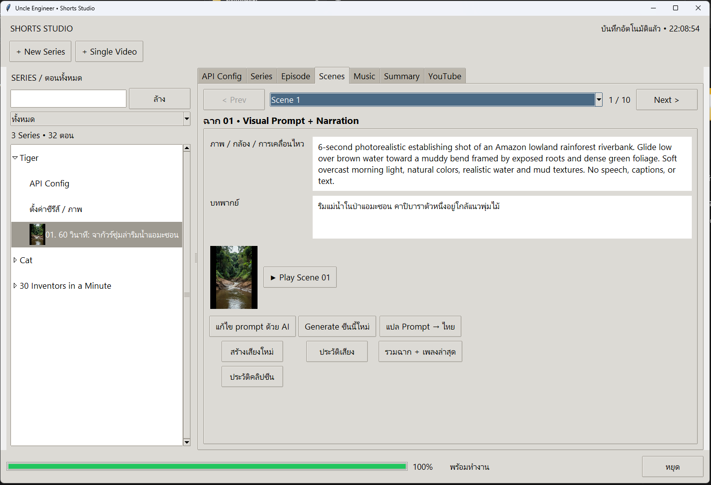

# Uncle Shorts Generator

โปรแกรม Windows สำหรับสร้าง YouTube Shorts ด้วย AI ตั้งแต่คิดหัวข้อ เขียนบท สร้างวิดีโอรายซีน เสียงพากย์ และเพลง จนถึงรวมคลิปและอัปโหลด YouTube

**Developed by [Uncle Engineer](https://uncle-engineer.com/)** · เวอร์ชัน **1.0.1**



ภาพตัวอย่างจากหน้าจอระหว่างพัฒนา ชื่อบนภาพอาจเป็นชื่อเดิมของโปรแกรม

- [ดาวน์โหลด Windows installer](https://github.com/UncleLabsBlacksmith/UncleShortsGenerator/releases/latest)
- [วิดีโอสาธิต](https://www.youtube.com/watch?v=eVC1pP2X5K8)
- [คู่มือภาษาไทย](USER_GUIDE.md)
- [แจ้งปัญหา](https://github.com/UncleLabsBlacksmith/UncleShortsGenerator/issues)

## เริ่มใช้งาน

1. ดาวน์โหลด `UncleShortsGenerator-Setup-1.0.1-x64.exe` จาก Releases แล้วติดตั้งบน Windows 10/11 แบบ 64 บิต ไม่ต้องลง Python หรือ FFmpeg เพิ่ม
2. เปิดโปรแกรม เลือก **New Series** หรือ **Single Video**
3. ที่ **API Config** ใส่ **API Key จาก OpenRouter เท่านั้น** แล้วกด **Check API Key** และอัปเดตโมเดล/ราคา รับ key ได้ที่ [OpenRouter](https://openrouter.ai/settings/keys)
4. เลือกโมเดลที่รองรับงานนั้น ๆ ใน **Series** กำหนดหัวข้อ ภาษา รูปแบบ และความยาว จากนั้นคิดหัวข้อ
5. เลือก EP ที่ต้องการ แล้วกด **เขียนบทตอนนี้** ตรวจบท/พรอมต์ใน **Scenes** ก่อนสร้างคลิปที่ **Summary**
6. ตรวจวิดีโอและต้นทุน ก่อนเผยแพร่ใน **YouTube**

ต้องมีอินเทอร์เน็ตและเครดิต OpenRouter โมเดล วิดีโอ เสียง และเพลงที่ใช้ได้ขึ้นกับบัญชีและรายการที่ API ส่งคืน ค่าใช้จ่ายจากการ Generate และ Generate ซ้ำเป็นของผู้ใช้ โปรแกรมไม่รวมเครดิตฟรี

## ทำอะไรได้บ้าง

- Series หลายตอน หรือคลิปเดี่ยว พร้อมค้นหา Series/EP และบันทึกอัตโนมัติใน SQLite
- เลือก/ค้นหา/กรองโมเดลพร้อมราคา; ตรวจ API Key และ Google OAuth
- แก้บทพากย์ พรอมต์รายซีน ขอ AI ช่วยแก้ และเปิดคำแปลภาษาไทยในหน้าต่างแยก
- สร้างใหม่เฉพาะซีน ฟัง/ดูตัวอย่าง เก็บประวัติเสียงและเวอร์ชันคลิป
- รวมวิดีโอกับเสียงและเพลงล่าสุด เปิดโฟลเดอร์ผลลัพธ์ ดู thumbnail และเล่นคลิป
- Summary รวม log, progress สีเขียวแบบเปอร์เซ็นต์ และต้นทุนจริง/ประมาณการตามข้อมูลที่มี
- สร้างต่อจากงานค้าง รับมือ HTTP 429 ตามระยะเวลารอ และเริ่มคำขอใหม่เมื่อผู้ใช้สั่ง Generate ใหม่
- อัปโหลด YouTube พร้อมเลือกตอน ความเป็นส่วนตัว เขตเวลา และคัดลอกลิงก์หลังสำเร็จ

## รันจากซอร์ส

ใช้ Python 3.11+ แบบ 64 บิตพร้อม Tkinter บน Windows และติดตั้ง FFmpeg/ffprobe ให้เรียกจาก PATH ได้

```powershell
python -m venv venv
.\venv\Scripts\python.exe -m pip install -r requirements.txt
.\venv\Scripts\python.exe shorts_studio.py
```

ใส่ key ในโปรแกรม หรือกำหนด `OPENROUTER_API_KEY` ในสภาพแวดล้อมของเครื่อง ห้ามใส่ key ลงในซอร์ส โครงการนี้ไม่แจก Google OAuth client/token: หากต้องการอัปโหลด ให้เปิด YouTube Data API v3 ใน Google Cloud สร้าง OAuth client แบบ Desktop app ดาวน์โหลด JSON และเลือกไฟล์ในแท็บ YouTube

## Build installer ด้วย Inno Setup

ต้องมี [Inno Setup 6](https://jrsoftware.org/isinfo.php), Python และ dependencies ตามด้านบน รวมถึง FFmpeg/ffprobe ใน PATH

```powershell
.\venv\Scripts\python.exe build_installer.py --check
.\venv\Scripts\python.exe build_installer.py --version 1.0.1
```

ผลลัพธ์อยู่ใน `dist/installer/` ตัว builder ใช้รายการไฟล์ซอร์สที่อนุญาต คัดลอก runtime/dependencies และตรวจการทำงานแบบ offline ก่อน compile ไม่คัดลอกโปรเจกต์หรือ credentials ดูตัวเลือกเพิ่มเติมด้วย `--help` สามารถระบุ `--iscc`, `--python`, `--ffmpeg-dir` ได้

## ทดสอบ

```powershell
.\venv\Scripts\python.exe -m unittest test_installer test_scene_generation test_router_retry test_studio test_shorts test_models test_media_versions test_youtube_costs
```

ทดสอบแบบ offline ไม่ใช้เครดิต API และไม่เผยแพร่วิดีโอ บางชุดทดสอบต้องมี Tkinter display และ FFmpeg

## ข้อมูลส่วนตัวและไฟล์เผยแพร่

ซอร์สรันในโฟลเดอร์โปรเจกต์จะเก็บข้อมูลใน `data/` ส่วน installer เก็บใน `%LOCALAPPDATA%\UncleEngineer\UncleShortsGenerator` และใช้โฟลเดอร์ `ShortsStudio` เดิมต่อหากพบ เพื่อรักษาข้อมูลเดิม การถอนติดตั้งไม่ลบข้อมูลผู้ใช้

API key ที่บันทึกบน Windows ใช้ DPAPI ผูกกับผู้ใช้เครื่องนั้น Google token เป็นไฟล์ส่วนตัว ห้ามอัปโหลดทั้งฐานข้อมูลและ token ไป GitHub ดูรายการไฟล์เผยแพร่และรายการยกเว้นใน [PUBLISHING.md](PUBLISHING.md) และ `.gitignore`

## License

โค้ดโปรแกรมใช้ [MIT License](LICENSE) ส่วน Python, FFmpeg และ dependencies ใช้สัญญาอนุญาตของตนเอง ดู [THIRD_PARTY_NOTICES.md](THIRD_PARTY_NOTICES.md) และโฟลเดอร์ licenses ใน installer
